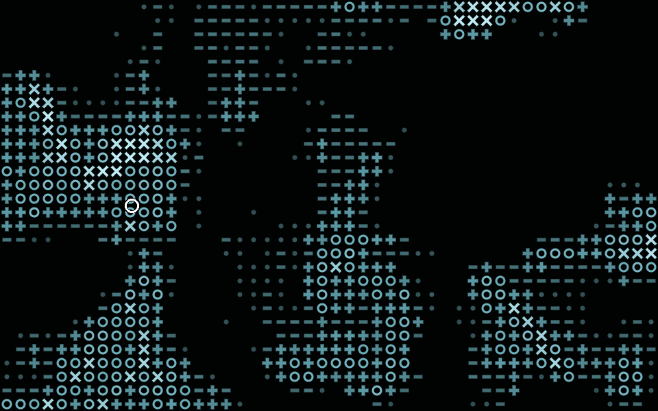
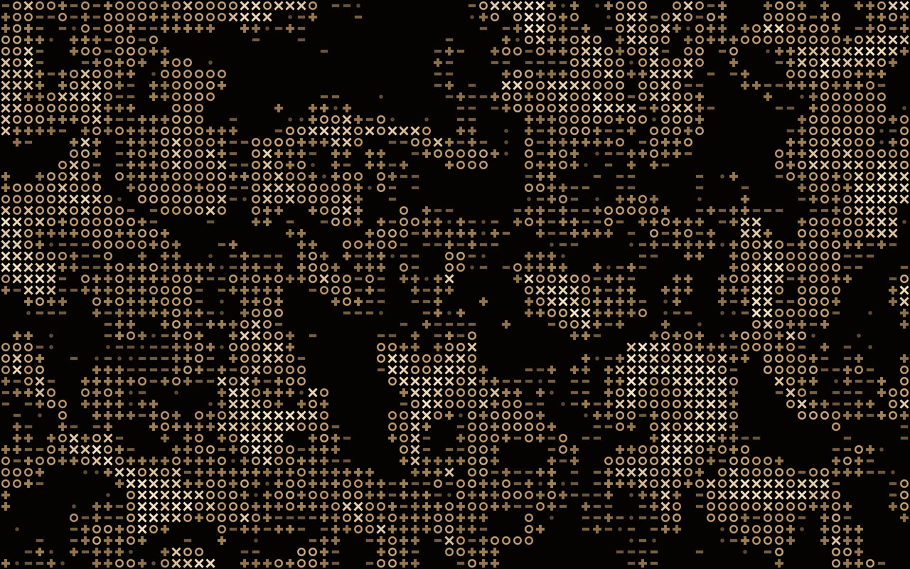
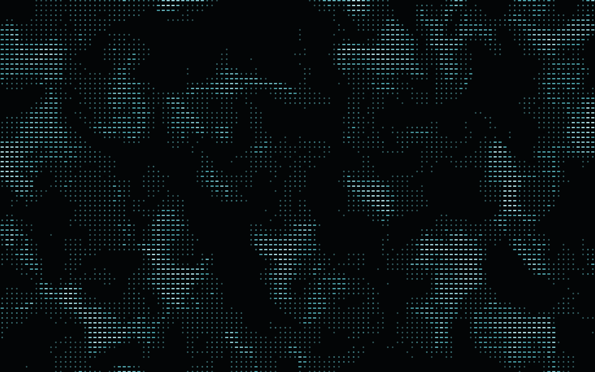

# situ

> *situ*, run through a substitution alphabet keyed with *fluid*, reads *rest*.

A tiny live wallpaper for Wayland: a field of ASCII glyphs that behaves like
fluid. Move the pointer over the desktop and the glyphs swirl, smear and morph,
then flow back to rest. When nothing moves, it does nothing.



| `--color e8be7c --bg 040302 --contrast 2.2 ...` | `--color 2897a1 --ramp ' .-' --rows 75 ...` |
|---|---|
|  |  |

One art style, done well: procedural glyph fields with smooth glyph morphing
and a monochrome palette from a single seed color. Everything else is a flag.

## Requirements

A Wayland compositor with layer-shell support: Sway, Hyprland, niri, river,
Wayfire, labwc, KDE Plasma and others.

## Install

Prebuilt Linux binaries (x86_64, aarch64) are on the
[releases](../../releases) page. Or build it with `rustup` installed:

```sh
cargo install --git https://github.com/Cod3dDOT/situ
```

## Use

Start it from your compositor config:

```sh
exec situ --color 5ca9b7                   # sway / river / i3-style
exec-once = situ --color 5ca9b7            # Hyprland
spawn-at-startup "situ" "--color" "5ca9b7" # niri
```

Starting it again replaces the running instance, so you can tweak flags live
from a terminal. Prefer a still wallpaper? `--static` draws the same art once
and takes no input.

| Input | Effect |
|---|---|
| move | push the fluid |
| left / right click | burst / implode |
| scroll | swirl |
| middle click | toggle continuous ambient flow |
| touch: drag / tap | push the fluid / burst |

### Options

```
Mode:    --static
Color:   --color HEX  --bg HEX  --gamma F
Look:    --ramp STR  --rows N  --scale F  --octaves N  --warp F
         --blank F  --contrast F  --seed N
Motion:  --fps F  --damping F  --relax S  --vorticity F  --force F
         --radius CELLS  --ambient [F]
```

`situ --help` describes each option. `--rows` sets the cell size relative
to the screen height, so the wallpaper looks the same on every monitor.
`--ramp` takes glyphs from `. - + o x | = : # / \ ~ ^ * @ %`, darkest first; a
space is blank.

## Development

```sh
cargo test                   # unit tests and engine invariants
scripts/prof.sh              # benchmarks, A/B against a git ref, profiling
scripts/gif.sh               # re-render assets/demo.gif
scripts/build-release.sh     # release binary (pinned nightly)
cargo run --release --example preview -- out.ppm --stir   # offline render
```

## License

MIT or Apache-2.0, at your option. The project is
[REUSE](https://reuse.software) compliant; see `REUSE.toml` and `LICENSES/`.
